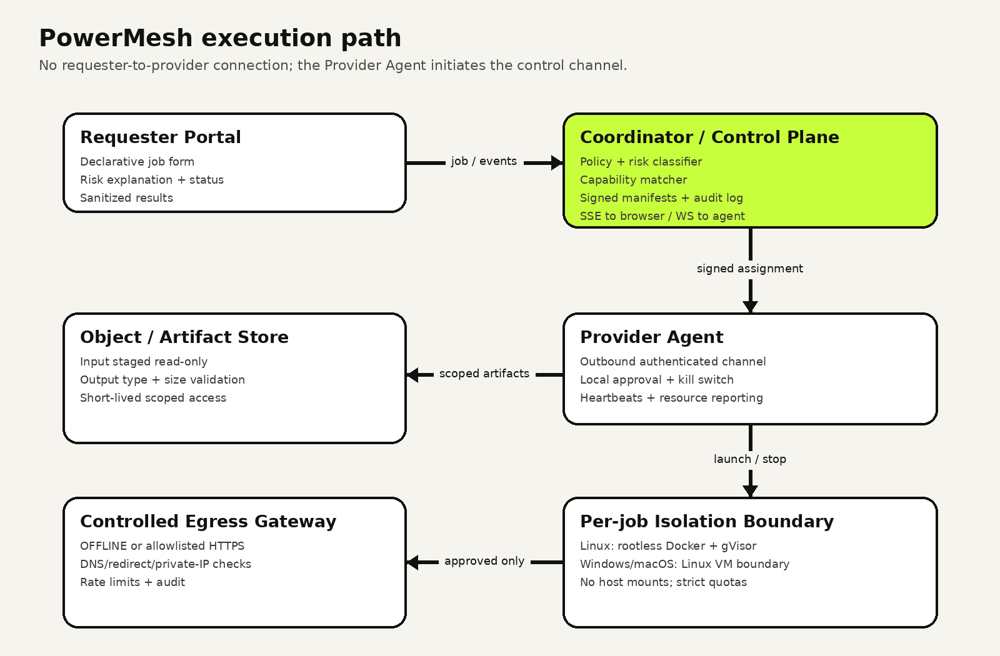

# PowerMesh — Project Context

> Living context file. Part A is the **live status** (updated every work session). Part B is the
> **Fresh-Start Master Plan v1.0 (10 Oct 2026)** transcribed from
> `PowerMesh_Fresh_Start_Master_Plan.docx` — the single source of truth until a newer version replaces it.

---

# PART A — LIVE STATUS

**Working as:** Gargi (product design, frontend, experience)
**Partner:** Kavya (backend, security, infrastructure)
**Current phase:** Phase 2 — Execute, started. `gargi-ui` carries Kavya's backend merged from `main`; the job screens
run against the real coordinator in **live mode**, and the public demo runs in the offline simulator. Other surfaces
wait for API endpoints.
**Last updated:** 2026-10-11

## Gargi task tracker

"Done (mock)" = meets the master-plan "done when" against the in-app mock + draft contracts. It still needs the
real contracts (S1) and integration (S2) before it's done by the Definition of Done in §10.

| ID | Pri | Deliverable | Status | Notes |
| --- | --- | --- | --- | --- |
| G1 | P0 | Information architecture and route map | ✅ draft v0 — needs Kavya review | `docs/design/G1-information-architecture.md` (routes, role matrix, flows, state→copy, 12 contract questions) |
| G2 | P0 | Design tokens and core components | ✅ v1 — theme "2077" | `packages/ui` — tokens + 13 components; dark 2077 theme (tweakcn); `pnpm check:contrast` 35/35 AA. Doc: `docs/design/G2-design-system.md` |
| G3 | P0 | Responsive app shell | ✅ | Sidebar ≥960px, drawer below; role-scoped nav; skip link; no h-scroll at 375px |
| G4 | P0 | Requester Job Composer | ✅ done (mock) | `/jobs/new` — signed catalogue, inputs, bounded params, network, live risk preview, error summary, blocked reasons |
| G5 | P0 | Provider Console | ✅ done (mock) | `/provider` — reads the Agent's local API (Q21/ADR-002), works with the coordinator down; Agent vs Coordinator status; pinned kill bar (Ctrl + .) with Q22 stop events; auto-pause + resume; probe status (Q11); `/provider/policy` with time zone + 6 caps (Q13) |
| G6 | P0 | Approval Sheet | ✅ done (mock) | `/provider/offers/[id]` — digest, signature, data, limits, network, risk facts, countdown, expired/auto-approved states |
| G7 | P0 | Job Flight Recorder | ✅ done (mock) | `/jobs/[id]` — SSE timeline, dedupe by seq, Last-Event-ID resume, backoff ≤ 15 s, stale after 12 s (Q19), attempt groups + lease retry banner (Q1), queue timeout note (Q2), cancel while Offered (Q3). Outage test: 0 duplicates |
| G8 | P0 | Result experience | ✅ done (mock) | Raster-only preview via scoped expiring URL; SVG/HTML download-only; digests + validation checks; rejected artifacts shown for audit, never previewed or downloadable (Q14); no `dangerouslySetInnerHTML` anywhere |
| G9 | P1 | Control Room and node visualization | ✅ done (mock) | `/control-room` — health, capacity, active jobs, mesh view + node table; requester sees aggregate only |
| G10 | P1 | Policy & Audit interface | ✅ done (mock) | `/audit` — role-scoped, server-side search + type filter, cursor pages ("Load older"), server-side CSV/JSON export (Q17), blocked submissions by `sat_` id (Q6), "why allowed/blocked" panel |
| G11 | P1 | Complete state coverage | 🟡 most done | Loading/empty/offline/error/cancelled/retrying/declined/expired (offer + queue)/degraded/stale/rejected-output exist. Not yet produced by the mock: TIMED_OUT (`EXECUTION_TIMEOUT`), expired download link |
| G12 | P1 | Accessibility and responsive QA | 🟡 started | Done: contrast AA, keyboard kill flow verified, focus management, live regions, reduced motion, 375px overflow check. To do: full keyboard pass on every flow, screen-reader pass, Playwright + axe |
| G13 | P1 | Demo content and visual assets | 🟡 started | `apps/web/scripts/generate-samples.py` → 3 safe abstract images (2–3 MB PNG → 26–190 KB WebP). Mentor runbook `docs/demo/mentor-demo.md`. To do: screenshot set, fallback recording |
| G14 | P2 | Restricted-network workload UI | ⬜ todo | Blocked on K14 egress gateway |

Legend: ⬜ todo · 🟡 in progress · ✅ done · ⛔ blocked

## How to run

`pnpm install`, copy `.env.example` → `.env` (repo root), then `pnpm dev:api` (coordinator, :4000) and
`pnpm dev:web` (:3000, or `$PORT`). `NEXT_PUBLIC_POWERMESH_MODE=live` in `.env` turns on live mode; unset/`offline-demo`
(`mock` still accepted) = fully simulated. Preview config `web-demo` runs the offline demo on :3200 next to a live app. Without Docker, comment out `DATABASE_URL` so the API uses its in-memory store.
On this machine: Node 20.20 (repo asks ≥22 — works so far), and pnpm must run with
`--config.manage-package-manager-versions=false` (self-switch to pnpm 12.10.1 fails on Windows).
`NEXT_PUBLIC_*` values are read at server start — restart `next dev` after changing `.env`. Sidebar: **Viewing as** (role switch) and **Demo
controls** (Agent disconnect, coordinator down, local emergency stop, incident, pace, reset). Demo click path in `README.md`.

## What exists (frontend)

```
package.json, pnpm-workspace.yaml      minimal workspace root (Kavya may extend with Turborepo/CI — K1)
packages/ui/                           @powermesh/ui — tokens.css, base.css, components, scripts/check-contrast.mjs
apps/web/                              @powermesh/web — Next.js 16.4, React 19.3, TypeScript 5.9
  src/app/                             routes per G1 §2 + /api/mock/* (offline-demo coordinator, v0 contract shapes)
  src/contracts-draft/                 ⚠ DRAFT types per Kavya's answers; job states + transitions imported from @powermesh/contracts
  src/mock/                            in-memory simulator (seed.ts, store.ts, http.ts)
  src/components/                      shell, composer, recorder, provider, control, audit, common
  src/lib/                             api client, hooks (useResource, useJobStream), copy, session
  mock-artifacts/                      demo outputs served ONLY via scoped-token route (never public)
  src/server/coordinator.ts            live bridge to the coordinator API (server-only)
  src/app/api/live/v1/*                live-mode routes (jobs, events, workloads, health)
apps/api/, apps/agent/, packages/contracts/   Kavya's coordinator, provider Agent, shared contracts (merged)
docs/design/                           G1 IA + route map, G2 design system
.claude/launch.json                    preview configs: web (:3000), web-demo (offline demo, :3200), api (:4000), web-live (:3100)
```

## Session log

- **2026-10-11 (14, 11:30)** — Pulled GitHub: `main` (= our #12 squash) and Kavya's `integration/gargi-ui` (11 commits:
  UI wired to coordinator contracts via `getCatalogue()`, landing page, top-bar nav, Windows NVIDIA GPU workload +
  `docs/demo/windows-gpu-demo.md`, migrations before API start, no-input workloads). 10 conflicted files resolved
  hunk by hunk: Kavya's side for her contract/catalogue work, our side kept for the Gemini note (Composer, bridge
  `explainRisk`) and the #12 lint fixes. Dropped our `coordinatorWorkloadId` helper (her `getCatalogue` replaces it).
  Renamed our heartbeat migration to `0007_node_heartbeat_history.sql` (Kavya's `0006_gpu_execution.sql` took 0006;
  it's idempotent). Landing page made semantic for Biome (figure, ul, real table, `.heroAccent`). Verified: Biome 0,
  turbo typecheck + test 9/9 (api 27, agent 36, contracts 23), web build, WCAG AA contrast, live smoke (health,
  catalogue, submit 201, risk explain), offline demo 41/41 (test reordered: RUNNING is now short).

- **2026-10-11 (14)** — **Lint cleanup to zero.** `biome check` was failing with 227 errors / 26 warnings; ~34 were only
  CRLF line endings from this machine. Fixed the rest in `apps/web` + `packages/ui`: import order + formatting
  (auto), real hook-dependency bugs in Composer (stable `paramValue`, removed unused memo), kill bar is now a
  labelled `<section>` landmark, non-null assertions replaced by a checked `must()` lookup in the mock, `forEach`
  value-returns → loops, `??=` assignment-in-expression in the live bridge, skeleton keys, alt text, CSS order.
  Deliberate patterns are suppressed **with a stated reason** (not silenced): `role="list"` (Safari drops list
  semantics), focusable scroll regions (WCAG 2.1.1), styled `role="meter"`, `` for signed artifact URLs (the
  image optimiser would cache them), `!important` in visually-hidden + reduced-motion. Result: Biome 0 errors /
  0 warnings over 189 files; typecheck 5/5; tests 78 passed, 1 skipped; `pnpm build` green; all six surfaces
  render with no console errors. Committed with the AI risk-explanation work (Gemini explains, never decides) and
  pushed `gargi-ui`.

- **2026-10-11 (13, 08:45)** — Gargi committed + pushed `gargi-ui` (with Kavya's #10: matcher, Agent job loop, pinned
  image-transform workload). **Live bridge fixed for #10's contract** (`jobCreationSchema` is now
  `{workloadId (uuid), params, inputDigests}`): the bridge looks up the coordinator's catalogue id, sends typed params
  and no digests (artifact transport not wired), and classifies non-offline requests with the coordinator's own
  `/v1/risk/classify` to return RISK_BLOCKED. The API needs `POWERMESH_IMAGE_TRANSFORM_IMAGE` (a placeholder digest is
  in local `.env`; replace with Kavya's published one). **Sponsor tracks:** Gemini risk explainer on the coordinator
  (`apps/api/src/ai/`, `POST /v1/risk/explain`, template fallback, 10 tests) shown on New job (blocked) and the
  Approval Sheet; Tiger Data migration `0006_node_heartbeat_history.sql` (hypertable + compression + retention when
  TimescaleDB exists) + best-effort heartbeat history writes. Docs: `docs/INTEGRATIONS.md`. Not committed.
- **2026-10-11 (12, 01:52)** — Judgement round at 10:00 today. Decision recommended: **freeze the demo**. The matcher,
  the Agent job loop and a built image-transform workload (S2) are not attempted before the round: about 8–10 hours of
  work in Kavya's code, Docker is not installed on this laptop, and a half-wired live path would put the working
  offline demo at risk. Present S2 as the next milestone. Optional, separate from the demo: a 60-second isolation proof
  using `buildDockerArgs` flags, only if Kavya has Docker running.
- **2026-10-11 (11)** — **UI realigned to the newer answers on main** (Gargi's go-ahead; nothing committed). States back to the
  master-plan table + coordinator-v0 POLICY_CHECKED/APPROVED (contracts `jobStates` still lags → F7). Imported from
  `@powermesh/contracts`: `protocolTiming`, `TerminalReasonCode`, `ApiErrorCode`, `Artifact`, `IsolationLevel/Capability`,
  `ProviderPolicy`, `NetworkHealth`, `AuditEventType`. Offline demo rewritten: SUBMITTED → QUEUED → OFFERED → CLAIMED →
  STAGING → RUNNING → VALIDATING; decline → DECLINED, unanswered offer → EXPIRED/OFFER_EXPIRED, 5-min QUEUE_TIMEOUT;
  lease 30 s + 10 s grace → QUEUED attempt 2; 422 with `auditEventId`. **Provider Console moved back to the Agent's local
  API** (`/api/mock/agent/v1/local/*` simulates 127.0.0.1:4765): stop, availability and decisions are local and work with
  the coordinator down; stop events NETWORK_REVOKED → TERMINATION_REQUESTED → PROCESS_KILLED → WORKSPACE_CLEANED.
  Removed the coordinator console/stop/availability/decision routes; audit export is `POST /v1/audit/exports`. Policy
  editor gained longest run / max processes / max output. Q30: offline demo returns 404 in production builds unless
  `NEXT_PUBLIC_POWERMESH_OFFLINE_DEMO=1`, and the role cookie is ignored there (Tab B is always requester). Found while
  verifying: `apps/web/tsconfig.tsbuildinfo` (incremental) had hidden 76 type errors from plain `tsc` — always trust
  `next build` or delete the buildinfo. Verified: build, typecheck 5/5 (forced), tests 4/4 tasks, contrast AA, 41/41
  offline-demo flow checks (first run had 6 misses from cold route compiles; all pass warm), browser pass of console
  stop steps, coordinator-down console, policy save, requester timeline, live Tab B (requester only, real jobs).
- **2026-10-11 (10)** — **Pulled Kavya's merge** (`origin/main` = PRs #7–#9) into `gargi-ui` with `--no-commit`
  (staged, not committed; backup of the uncommitted UI work in `stash@{0}`). F1 resolved: the whole backend is on main.
  Main adds v0 contract schemas (`api`, `artifacts`, `capabilities`, `platform`, `provider`, `terminal`), hardened API
  auth, `docs/ADR-002-loopback-agent-console.md`, and a **newer answers file** (committed 22:24, "freeze"; the copy
  Gargi handed over was saved 22:03 → kept as `docs/handoff/answers-from-kavya.superseded-2026-10-10-2203.md`).
  The newer answers **reverse** Q1 (retry → QUEUED), Q2 (DECLINED / offer EXPIRED are job-terminal; QUEUED times out
  after 5 min), Q19 (heartbeat 5 s, stale 12 s), Q21 (Agent serves the Provider Console on 127.0.0.1:4765 with a
  local API), Q22 event names, Q8 `UNAUTHENTICATED`, Q11 drops `vm`, Q16 adds `reasonCode`. Session 9 followed the
  older file, so those rows need redoing once Gargi confirms (needs_both). The contracts also contradict themselves:
  `jobStates` still has 11 states, but `terminal.ts` uses REJECTED/DECLINED/TIMED_OUT and the answers use QUEUED/STAGING
  → follow-ups F7. No new API routes (still no matcher, Agent loop, list/events/stop/audit). Verified: typecheck 5/5,
  tests contracts 22, agent 29, API 10 (+1 skipped; "reports health" timed out once under parallel turbo load, passed
  twice alone), web build, contrast AA, 39/39 offline-demo flow checks, live smoke (submit → POLICY_CHECKED, list,
  open-web → 422 with risk), browser pass of Acts 1, 3–5 and 8. Demo-day note: Tab B's **Cancel job** answers
  "not available yet" (no API endpoint).
- **2026-10-10 (9)** — **UI aligned with Kavya's answers** (all "Now" rows of the decisions table, frontend only, nothing
  committed). Draft types rewritten to the v0 shapes; job states + transitions now **imported from
  `@powermesh/contracts`** (no DRAFT/QUEUED/STAGING/DECLINED/REJECTED/TIMED_OUT). Offline-demo coordinator rewritten:
  jobs start in SUBMITTED (Q5); blocked = 422 `RISK_BLOCKED` with risk + `sat_` id, audit only, no job (Q6); decline/expiry
  re-offers up to 3 times in a 120 s window, else EXPIRED `NO_PROVIDER_ACCEPTED` (Q2); cancel while OFFERED withdraws the
  offer, late decision → 409 (Q3); provider stop via `POST /v1/jobs/:id/stop` with Agent stop steps, CANCELLED only at
  `PROCESS_EXITED`, then auto-pause (Q12, Q21, Q22); lease expiry → OFFERED attempt 2 (Q1, proposed transition);
  cursor pages for jobs + audit, server-side audit search + export (Q15, Q17); IANA time zone + field keys in policy
  (Q13); probe status (Q11); `sizeBytes` + rejected artifacts (Q14); risk copy keyed by `RiskFactCode` (Q7);
  reason-code copy (Q4); params form from `paramsSchema` + `x-ui` (Q28); SSE heartbeat 10 s, stale 25 s (Q18/19);
  mode renamed `offline-demo` (Q30). Removed `/api/mock/agent/*` (loopback Agent). Added `/v1/provider/console`,
  `/v1/jobs/:id/stop`, `/v1/nodes/:id/availability`, `/v1/audit/export`, and a "Local emergency stop" demo control.
  Live bridge updated (nested `workload`, `Page` list, 422 → risk details). Verified: typecheck 5/5, tests
  14 + 10 + 29, contrast AA, web build, 39-check API flow script (all pass; 2 test-harness misses re-checked by hand),
  browser pass of console stop steps / coordinator-down / audit / policy / composer, live smoke vs real API.
  Fixed during QA: stop dialog stayed open after the job finished; Agent status shown as "connected" while the
  coordinator was down. New proposals → follow-ups F6. Demo runbook, README and `.env.example` updated.
- **2026-10-10 (8)** — **Kavya answered all 30 questions** → `docs/handoff/answers-from-kavya.md` (25 accept_with_changes,
  4 accept, 1 reject: Q21). Wrote `docs/handoff/follow-ups-for-kavya.md` with 5 follow-ups: **F1** her PRs #2–#6 never
  reached `main` (she asked us to rebase onto main, which would drop the backend); **F2** answers vs contracts disagree
  on the state machine (SUBMITTED vs POLICY_CHECKED at creation, retry/re-offer transitions, REJECTED/TIMED_OUT);
  **F3** SSE comment-line heartbeats are invisible to `EventSource`, so stale detection breaks — asked for a named
  `heartbeat` event; **F4** which answered endpoints and shapes are actually built, and when; **F5** small
  confirmations (real digest, local CLI stop command, mock default).

- **2026-10-10 (7)** — **Mentor demo runbook** → `docs/demo/mentor-demo.md` (S8/G13). About 8 min in 9 acts, following
  §11: full story on the simulator (Tab A :3000, `NEXT_PUBLIC_POWERMESH_MODE=mock` set in the shell overrides `.env`;
  verified), plus a "this part is real" act on the live app (Tab B :3100, `next start`) and the coordinator/Agent tests
  with `vitest --reporter=verbose` (API 10 ✓ 1 skipped, Agent 29 ✓). Includes setup checklist, talk track, real vs
  simulated table, mentor Q&A, and recovery steps. Use Narrated pace (×2) so an offer stays open for 120 s.

- **2026-10-10 (6)** — **Backend merged + frontend connected (live mode).** Nothing committed (Gargi's instruction).
  - Kavya's PRs #2–#6 were *stacked* (each merged into the branch below, not into `main`), so `origin/main` only has
    PR #1 (foundation). Merged `origin/kavya/sandbox-runtime` (= `controlled-egress` tree; contains every backend
    commit, and `origin/main`'s tree is already inside it) into `gargi-ui` with `--allow-unrelated-histories
    --no-commit`. Merge is **in progress, staged, uncommitted** — `git commit` finishes it, `git merge --abort` undoes it.
  - Conflicts resolved: root `package.json` (Kavya's turbo/biome/TS 7 + our `dev:web`, `dev:api`, `build:web`,
    `check:contrast`), `.gitignore` (union), `README.md` (Kavya's + Web app section), `apps/web/*` config (ours +
    `@powermesh/contracts`, TS 7.0.2, `@next/env`), lockfile regenerated. Kavya's Phase-0 placeholder page
    `apps/web/app/` moved to `docs/archive/phase0-landing-page/` (it would have shadowed `src/app`).
  - **Live bridge** `apps/web/src/server/coordinator.ts` + routes `/api/live/v1/{jobs,jobs/:id,jobs/:id/events,
    jobs/:id/cancel,workloads,health}`. Enrollment key stays server-side; requester token in httpOnly SameSite=Strict
    cookie scoped to `/api/live`; job list = cookie of remembered job ids (no `GET /v1/jobs`); SSE = polls
    `GET /v1/jobs/:id` and emits only states the coordinator reported (seq = lifecycle index → resume-safe);
    risk facts from `POST /v1/risk/classify`; requests validated with `jobCreationSchema` before sending.
  - UI now renders coordinator states verbatim: added `POLICY_CHECKED`, `APPROVED` to the UI state list + copy +
    milestones. `InputSummary.totalBytes`, `ResourceLimits.diskBytes/pids` are nullable → "Not reported" rather
    than invented numbers. UUID job ids shortened on cards.
  - Verified against the real API (in-memory store): submit → `POLICY_CHECKED` (LOW, coordinator reason shown);
    OPEN_WEB → 422 shown as "Blocked before scheduling (HIGH risk)…"; event stream + Last-Event-ID resume; cancel says
    "not available yet"; **requester isolation — found and fixed a bug** where the bridge's job cache served a job to
    a different/no credential (cache now keyed by requester-token digest). `next build` green; typecheck green
    (5 packages); tests 53 passed (contracts 14, agent 29, api 10; 1 Postgres test skipped).
  - ⚠ `pnpm lint` (biome) fails: real rule errors are in our UI code (organizeImports, noRedundantRoles on
    intentional `role="list"`, exhaustive-deps, a few a11y rules); every file also shows CRLF formatting noise on
    Windows. Not fixed yet — needs a dedicated pass.
- **2026-10-10 (5)** — **My jobs / All jobs is now a card grid**, not a table (Gargi's request: boxes + larger type).
  `apps/web/src/components/jobs/Jobs.module.css`. One box per job: id + state badge, workload (20px), inputs and risk
  (16px), requester for admin, attempt number, "Updated … · Open". The whole box opens the Flight Recorder
  through a stretched link, so there's one tab stop per job and the focus ring sits on the box. Grid is
  auto-fill ≥320px: 3 columns at 1440px, 1 at 375px, no horizontal scroll. `Badge` gained `size="lg"`
  (`JobStateBadge` passes it through). Typecheck green.

- **2026-10-10 (4)** — **Theme swapped to "2077"** (tweakcn community, playful tag, by Evan Jacobs; dark variant), at
  Gargi's request. Black canvas, white type, coral `#d6544b` accent, radius 0, Chakra Petch + IBM Plex Mono.
  `--pm-lime*` tokens renamed `--pm-accent*`; new `--pm-on-accent`, `--pm-accent-text`, `--pm-danger-fill`,
  `--pm-on-danger`, `--pm-backdrop`. Departures from the raw theme, for safety: crimson `#ea1330` danger fill so
  Stop ≠ Approve; green for LOW risk and healthy; panels lifted to `#0a0a0a`. Kill bar is now a dark well with a
  crimson border, not an inverted ink bar. Contrast checker extended to 35 pairs, all AA. Verified in browser:
  composer → offer → approval sheet → running kill bar; 375px has no horizontal scroll; typecheck green.
  Only the dark variant ships (2077's light variant has white borders on white).
- **2026-10-10 (1)** — Project folder was empty. Transcribed master plan into this file; copied Figure 1 to
  `docs/assets/execution-path.png`. Started G1.
- **2026-10-10 (3)** — Framed all open contract questions for Kavya's agent in
  `docs/handoff/questions-for-kavya.md` (30 questions; 18 marked P-S1 as blocking the contract freeze).
- **2026-10-10 (2)** — Wrote G1 (IA, route map, flows, state/copy table, contract questions). Scaffolded pnpm
  workspace + `apps/web` + `packages/ui`. Built G2 tokens/components, G3 shell, G4–G10 surfaces against a mock
  coordinator that enforces the canonical state table. Verified in browser: submit → offer → approve → run →
  validate → result; blocked (OPEN_WEB) path; keyboard kill (Ctrl + . → Enter → CANCELLED/PROVIDER_STOP, node paused);
  coordinator outage → reconnect with 0 duplicate events; provider disappears → lease expiry → requeue once;
  role boundaries (all cross-role API calls 403); tampered artifact signature 403. `next build` passes; contrast AA.
  Bugs found and fixed: requester could see node label in event actors (now redacted); Stop dialog focused × not
  "Stop now"; kill delay was scaled by demo pace; reconnected node stayed offline so requeued jobs never re-offered.

## Working assumptions (until Kavya's contracts v0 land)

- Kavya owns `packages/contracts` (K2) and the monorepo foundation (K1). Gargi's UI is built against
  **provisional draft fixtures** in `apps/web/src/contracts-draft/` that mirror §7 data model + §3 job states
  exactly, clearly marked DRAFT, to be swapped for `@powermesh/contracts` in S1.
- No invented job states: the UI uses the master-plan table the newer answers rely on, plus the coordinator-v0 states
  POLICY_CHECKED/APPROVED it sees in live mode. `packages/contracts` `jobStates` still lists the old 11 (F7). The Q1
  lease retry is isolated in `RETRY_TRANSITIONS`.
- The UI risk classifier is a *preview* only; the coordinator (K5) is authoritative.
- The old `D:\CODING\Web Dev\PowerMesh` repo is **research only** — do not copy code from it.
- Repo: GitHub `kavya-jain14/POWERMESH` (origin). Gargi works on branch `gargi-ui`; `main` is Kavya's integration branch.
- This Windows machine checks files out with CRLF (`core.autocrlf=true`); the repo stores LF. Run Biome locally
  with `--line-ending=crlf` (or it reports every file as misformatted); CI on LF is unaffected.

## Decisions from Kavya's answers (main, 2026-10-10 22:24) → UI work

Source: `docs/handoff/answers-from-kavya.md` as merged on main (the older 22:03 copy is kept as
`answers-from-kavya.superseded-2026-10-10-2203.md`). ✅ = done in the offline demo + draft types (session 11);
it still needs Kavya's API to match before it's done for real. Gargi confirmed the `needs_both` items on 2026-10-11
by asking for the UI to follow this file.

| Q | Decision | UI | Status |
| --- | --- | --- | --- |
| Q1 | Lease-expired idempotent job: CLAIMED/STAGING/RUNNING → QUEUED once, attempt 2 | `RETRY_TRANSITIONS`; LEASE_EXPIRED event; "Retrying on another eligible provider" | ✅ |
| Q2 | DECLINED and offer EXPIRED are job-terminal; QUEUED times out after 5 min (`QUEUE_TIMEOUT`) | Terminal copy by reasonCode; queue note | ✅ |
| Q3 | OFFERED → CANCELLED; withdrawn offer → 409 | Cancel enabled while Offered | ✅ |
| Q4 | Closed `TerminalReasonCode`, valid per terminal state (contracts `terminal.ts`) | `REASON_COPY` keyed by code; HEARTBEAT_MISSED is an event only | ✅ |
| Q5 | DRAFT client-only | Server timeline starts at SUBMITTED | ✅ |
| Q6 | 422 RISK_BLOCKED, no job, `details: { auditEventId, risk }` | Composer shows risk + audit reference; `JOB_REJECTED` audit row | ✅ |
| Q7 | `RiskFactCode` (renamed codes), labels from contracts copy | `RISK_FACT_COPY` in draft until contracts exports labels | ✅ draft |
| Q8 | `UNAUTHENTICATED`, `PAYLOAD_TOO_LARGE`; dotted field keys incl. `inputs.<n>`, `limits.timeoutSeconds/pidLimit` | Error titles + field mapping | ✅ |
| Q9 | JobView: nested workload, limits `timeoutSeconds/pidLimit/maxOutputBytes`, `maxAttempts`, nulls, assignment os/architecture | Types + every screen | ✅ |
| Q10 | Offer `policyRule: {code,label,policyVersion} \| null`, no nodeId | Approval Sheet renders label + code/version | ✅ |
| Q11 | No `vm`; probeStatus pending/verified/failed/unsupported; failureCode | Console + Control Room | ✅ |
| Q12 | Emergency stop auto-pauses | Resume sharing | ✅ |
| Q13 | Timezone + caps `timeoutSeconds/pidLimit/maxOutputBytes` | Policy editor: 3 new controls | ✅ |
| Q14 | `url/urlExpiresAt` null on failure; no `status` field | `isDownloadable()` | ✅ |
| Q15 | Cursor pages | Load older jobs/events | ✅ (mock) |
| Q16 | `reasonCode`, coordinator `online/degraded`, incident `title` | Control Room | ✅ |
| Q17 | Audit types from contracts; `POST /v1/audit/exports {format, filters}` | Export buttons POST | ✅ (mock) |
| Q18 | Replay then close; never reconnect after terminal | Already | ✅ |
| Q19 | SSE heartbeat 5 s, stale 12 s, lease 30 s + 10 s grace | `protocolTiming` imported from contracts | ✅ |
| Q21 | **Agent serves the Provider Console** on 127.0.0.1:4765; local `/v1/local/{state,stop,availability,offers/:id/decision}` | Console + decisions use `AGENT_BASE`; demo simulates it | ✅ (mock), wait for Agent |
| Q22 | NETWORK_REVOKED, TERMINATION_REQUESTED, PROCESS_KILLED, WORKSPACE_CLEANED; "Stopped" = PROCESS_KILLED | Stop steps in console + timeline + audit | ✅ |
| Q23 | Agent decides auto-approval; rule code + copy | policyRule object | ✅ |
| Q24 | Requester: os/architecture + isolation, no nodeId | Projection | ✅ |
| Q25 | Neutral input names | Already | ✅ |
| Q26 | GitHub OAuth, `GET /v1/me`, `POST /v1/me/active-role`, `pm_session` | Role cookie honoured only in the offline demo; real auth waits | Wait |
| Q27 | Presigned PUT → complete → `inputArtifactIds` | Composer hint says checks are early feedback | Wait |
| Q28 | Schema `title/description/x-unit`, `imageDigest`, `input.maxBytesPerFile`; reject non-sha256 | Schema-driven form + enum fallback labels | ✅ |
| Q29 | Node 22+, keep repo layout | Upgrade Node on this machine | Todo |
| Q30 | Offline demo only, "Offline demo data" banner, off in production builds | `NEXT_PUBLIC_POWERMESH_OFFLINE_DEMO` gate | ✅ |

## Open questions for Kavya

**Integration gaps found while connecting (2026-10-10):**

- A. No `GET /v1/jobs` (list mine) — bridge remembers ids in a cookie. B. No job event read/stream endpoint —
  `job_events` is stored but unreadable; bridge polls `GET /v1/jobs/:id`. C. No cancel endpoint. D. No matcher —
  live jobs stop at `POLICY_CHECKED` because offers are only created via the coordinator key. E. Agent has no local
  HTTP/loopback API, so the Provider Console/Approval Sheet/kill switch can't go live (G1 Q9). F. No nodes /
  network / audit / workloads read endpoints. G. `JobRecord` isn't exported from `@powermesh/contracts`. H. API stores
  input digests only — no sizes/types, no upload/artifact pipeline. I. Error bodies are `{error: CODE}` without a
  message/correlationId (UI proposal Q4). J. Rate limit 100/min per IP is shared by everything behind the web server.
  K. State machines differ: contracts have `POLICY_CHECKED`/`APPROVED`, no `QUEUED`/`STAGING`/`DECLINED`/`REJECTED`/
  `TIMED_OUT`; blocked jobs aren't persisted (422 only). The mock still uses the master-plan table → decide in S1.

**Formal handoff:** `docs/handoff/questions-for-kavya.md` — 30 questions (Q1–Q30), grouped A–G, with
priority (P-S1 / P-2 / P-later), what the UI does today, proposals, and a YAML reply format. Kavya's agent
answers into `docs/handoff/answers-from-kavya.md`. Summary of the original 12 (G1 §6):

1. Retry representation (lease-expiry requeue isn't in the state table).
2. Is DECLINED/EXPIRED of an offer terminal, or does the matcher re-offer?
3. Risk explanation object shape (`{tier, facts[{code,label,effect}], policyVersion, decidedAt}` proposed).
4. Error envelope (`{error:{code,message,fields?,correlationId}}` proposed).
5. SSE event shape + Last-Event-ID resume.
6. Node capability view must separate declared vs verified isolation.
7. Kill-path event: `CANCELLED` + reason `PROVIDER_STOP` / `REQUESTER_CANCEL` / `ADMIN_STOP`.
8. Offer payload for the Approval Sheet (no filenames).
9. Where the Provider Console talks to — proposal: local loopback Agent endpoint for stop + decision (needs ADR).
10. Requester cancel during OFFERED (not allowed by the current table).
11. Read endpoints missing from API v0: `GET /v1/jobs`, `/v1/workloads`, `/v1/nodes`, `/v1/network`, `/v1/offers/:id`.
12. Requester-facing actor redaction must happen server-side.

## Next up (Gargi)

**Updated 2026-10-11 (11):** UI follows the newer answers. Next: send F7 to Kavya (contracts `jobStates` must match the
answers; PROCESS_KILLED vs graceful exit); wire live routes as her endpoints land (list, events, cancel, offers, nodes,
audit, `/v1/me`, uploads) and point `NEXT_PUBLIC_POWERMESH_AGENT` at the real Agent once it serves `/v1/local/*`.
Frontend-only leftovers: G11 TIMED_OUT + expired-link paths, G12 Playwright + axe, G13 screenshots, Node 22, lint chip.

0. Review + commit the merge (uncommitted on `gargi-ui`); biome lint pass on `apps/web` + `packages/ui`; send gaps
   A–K above to Kavya (add to `docs/handoff/questions-for-kavya.md`).

1. Review G1 with Kavya → freeze v0 contracts together (S1); replace `contracts-draft` imports.
2. G11: add mock paths for TIMED_OUT, DECLINED and expired-link states; verify every state screen.
3. G12: Playwright + axe suite for the two Gargi-owned acceptance tests (UI reconnect/stale; keyboard approval + stop).
4. G13: screenshot set + fallback recording of the demo click path.

---

# PART B — FRESH-START MASTER PLAN v1.0

**POWERMESH — Fresh-Start Master Plan.** A build-ready blueprint for a safer peer-compute network.

| | |
| --- | --- |
| OWNERS | Kavya — backend, security, infrastructure · Gargi — product design, frontend, experience |
| BUILD RULE | Use prior learning, not prior implementation. Start with a clean repository and explicit interfaces. |
| MVP PROMISE | Share a capability, not a device. |
| VERSION | v1.0 / 10 October 2026 |

Fresh start, same hard-won lessons. Technical decisions are treated as hypotheses until their security tests pass.

## How to use this master plan

Converts the PowerMesh idea into a two-person delivery plan. Locks MVP boundaries, assigns accountable owners,
defines interfaces, and makes security claims testable. When scope pressure appears, **protect the offline
vertical slice first** and move stretch items out.

| Section | Purpose |
| --- | --- |
| 1. Product charter | Problem, promise, audience, success criteria |
| 2. Scope and decisions | What is in, out, locked, or deferred |
| 3. Architecture | Components, trust boundaries, job lifecycle |
| 4. Security model | Risk tiers, isolation, network, threats |
| 5. Cross-platform model | Windows, macOS, Linux compatibility |
| 6. Product and UX | Screens, states, copy, accessibility |
| 7. Technical blueprint | Stack, repository, data, APIs |
| 8. Ownership plan | Kavya, Gargi, shared work, handoffs |
| 9. Milestones | Phase plan and exit criteria |
| 10. Verification | Acceptance tests and definition of done |
| 11. Demo and pitch | Narrative, fallback, differentiation |
| 12. First actions | Immediate checklist and open decisions |

**Priority legend:** P0 = required for a credible end-to-end demo · P1 = required for a robust hackathon
submission · P2 = stretch, only after every P0 acceptance test passes · Blocked = explicitly prohibited in the
personal-provider MVP.

---

## 1. Product charter — What PowerMesh is building

PowerMesh is a trusted-community compute network where a provider shares a narrowly defined capability — such
as running an approved image-processing workload — without exposing their whole computer. A requester submits a
declarative job, the coordinator chooses a compatible provider, and a local agent executes the job inside a
hardened boundary.

**One-sentence promise:** Share spare compute safely, with visible consent and enforceable limits — never remote
access to someone's machine.

### Primary users

| User | Need | PowerMesh experience |
| --- | --- | --- |
| Requester | Finish a bounded compute task without owning the required hardware | Choose a supported task, upload inputs, see cost/risk/status, receive validated output |
| Provider | Contribute spare capacity without surrendering device control | Declare capability and policy, approve work, monitor limits, stop instantly |
| Community admin | Keep a campus/lab pool trustworthy | Approve nodes/workloads, review incidents and audit events |

### Hackathon success criteria

- A requester can submit the approved offline workload and receive a validated artifact.
- A provider can join, publish capabilities, approve or auto-approve by policy, view live progress, and kill the job.
- No requester gains a shell, desktop session, provider IP address, Docker socket, host path, or provider credential.
- Risk classification is deterministic and explainable; blocked jobs are rejected before scheduling.
- The team can demonstrate isolation, limits, failure recovery, auditability, and a clear path across Linux, Windows, and macOS.

**Differentiation:** Decentralized compute is not the unique claim. The wedge is capability-first sharing with
explicit per-job consent, explainable risk tiers, controlled egress, a local kill switch, and an approachable
experience for trusted campus or lab communities.

---

## 2. Scope and decisions — MVP boundary

| MVP includes | MVP excludes |
| --- | --- |
| Curated, signed workload definitions | Arbitrary user code or arbitrary container images |
| Offline-by-default execution | Unrestricted internet from personal provider devices |
| Capability matching by OS/arch/runtime/resources | Whole-device rental, SSH, RDP, inbound provider ports |
| Per-job approval and provider kill switch | Background execution without visible policy or consent |
| One visual workload: batch image transform | General-purpose GPU marketplace |
| Linux reference node; Windows/macOS boundary adapters | Native Metal/CUDA workloads in the first vertical slice |
| Coordinator, Agent, Portal, artifact store, audit events | Billing, tokens, public anonymous marketplace |

### Decision register

| Decision | Status | What it means |
| --- | --- | --- |
| Core interaction | LOCKED | Declarative job; never remote control or interactive shell |
| Requester/provider connection | LOCKED | All coordination through control plane; provider agent opens outbound channel |
| Runtime internet | LOCKED | OFFLINE default; RESTRICTED only through egress gateway |
| Risk classification | LOCKED | Deterministic rules; not an AI-generated score |
| Fresh codebase | LOCKED | New repository/monorepo; reuse concepts and tests, not legacy code |
| Primary demo workload | MVP | Offline batch image resize/format/compress with fixed parameters |
| Linux isolation | MVP | Rootless Docker; gVisor when supported; hardened baseline always |
| Windows/macOS | MVP | Linux VM boundary and capability adapter; verify on real machines |
| Controlled web workload | DEFERRED | Optional GitHub metadata task after offline slice is green |
| High-risk jobs | BLOCKED | Dedicated verified microVM pool only; never personal-device MVP |

**Scope rule:** If a feature does not improve the end-to-end demo, prove a safety claim, or clarify the
provider/requester experience, it waits. Security controls must be implemented and tested — not only shown as UI labels.

---

## 3. Architecture — System shape and trust boundaries



*Figure 1. Reference execution path. All provider communication is agent-initiated; the sandbox has no access to
the host or control plane credentials.* Diagram content:

- **Requester Portal** (declarative job form · risk explanation + status · sanitized results) —`job / events`→ **Coordinator / Control Plane**
- **Coordinator** (policy + risk classifier · capability matcher · signed manifests + audit log · SSE to browser / WS to agent) —`signed assignment`→ **Provider Agent**
- **Provider Agent** (outbound authenticated channel · local approval + kill switch · heartbeats + resource reporting) —`scoped artifacts`→ **Object / Artifact Store** (input staged read-only · output type + size validation · short-lived scoped access)
- **Provider Agent** —`launch / stop`→ **Per-job Isolation Boundary** (Linux: rootless Docker + gVisor · Windows/macOS: Linux VM boundary · no host mounts; strict quotas)
- **Isolation Boundary** —`approved only`→ **Controlled Egress Gateway** (OFFLINE or allowlisted HTTPS · DNS/redirect/private-IP checks · rate limits + audit)
- No requester-to-provider connection; the Provider Agent initiates the control channel.

### Component responsibilities

| Component | Owns | Must never own |
| --- | --- | --- |
| Requester Portal | Job form, status, sanitized previews | Provider address, secrets, shell controls |
| Coordinator API | Auth, jobs, policy, matching, events, audit | Host execution privileges |
| Provider Agent | Capability report, consent, local lifecycle, heartbeats | Requester-supplied commands |
| Sandbox adapter | Start/monitor/stop one approved workload | Personal folders, Docker socket, privileged mode |
| Artifact store | Scoped input/output transfer | Permanent public URLs |
| Egress gateway | Allowed destinations, DNS/IP checks, quotas, logs | General proxy access |

### Job lifecycle

1. Requester selects a signed workload definition and submits parameters plus input metadata.
2. Coordinator validates the schema, calculates a deterministic risk tier, and rejects blocked combinations.
3. Matcher filters provider nodes by trust, OS, architecture, runtime, resources, policy, and isolation level.
4. Coordinator creates an expiring signed manifest: job ID, workload digest, input digest, limits, nonce, network policy.
5. Provider Agent receives the offer over its outbound authenticated channel and applies local consent policy.
6. Agent atomically claims the assignment, stages inputs into a read-only directory, then launches a single per-job sandbox.
7. Sandbox writes progress locally; Agent streams normalized events to the coordinator. It never needs internet for telemetry.
8. Agent validates outputs by type, size, and schema, uploads them with a short-lived scoped token, reports the result digest.
9. Coordinator finalizes status and exposes sanitized results. Workspace cleanup is verified and recorded.

### Canonical job states

| State | Allowed next states | Owner |
| --- | --- | --- |
| DRAFT | SUBMITTED, CANCELLED | Requester |
| SUBMITTED | REJECTED, QUEUED | Coordinator policy |
| QUEUED | OFFERED, CANCELLED, EXPIRED | Matcher |
| OFFERED | CLAIMED, DECLINED, EXPIRED | Provider Agent |
| CLAIMED | STAGING, FAILED, CANCELLED | Provider Agent |
| STAGING | RUNNING, FAILED, CANCELLED | Provider Agent |
| RUNNING | VALIDATING, FAILED, CANCELLED, TIMED_OUT | Sandbox + Agent |
| VALIDATING | SUCCEEDED, FAILED | Provider Agent |
| Terminal | No transition | Coordinator |

Terminal states: SUCCEEDED, FAILED, CANCELLED, REJECTED, EXPIRED, DECLINED, TIMED_OUT.

**Failure semantics:** A claim is a lease, not ownership forever. Missing heartbeats expire the lease; only
idempotent workloads may be requeued automatically. Every transition is append-only in JobEvent and must include
actor, timestamp, reason, and correlation ID.

---

## 4. Security model — Defense in depth

Docker is not treated as an impenetrable security boundary because containers share the host kernel. PowerMesh
combines multiple controls so one failure does not automatically expose the provider device.

| Layer | Control | MVP implementation |
| --- | --- | --- |
| Identity | Authenticated nodes and users | Short-lived tokens; mTLS-ready agent channel |
| Authorization | Capability and policy scopes | Workload allowlist; deny by default |
| Supply chain | Known immutable workload | Signed image; fixed digest; SBOM and scan gate |
| Process | Least privilege | Rootless user; no privileged mode; drop capabilities |
| Kernel | Restricted attack surface | Default-deny seccomp; AppArmor/SELinux profile where available |
| Boundary | Extra syscall mediation or VM | gVisor on supported Linux; Linux VM on Windows/macOS |
| Filesystem | No host data exposure | /input read-only; /work temp; /output isolated; no personal mounts |
| Resources | Bounded blast radius | CPU, RAM, PIDs, disk, bandwidth, and wall-clock limits |
| Network | No ambient connectivity | OFFLINE default; controlled egress gateway for RESTRICTED |
| Operations | Provider remains in control | Visible approval, live status, emergency kill switch, cleanup audit |

**What gVisor adds — and does not add:** intercepts many syscalls in a userspace kernel, reducing direct host
kernel exposure. Extra layer, not a guarantee. Expect perf overhead, incomplete syscall compatibility, harder
debugging, limited accelerator support, Linux-centric. Unsupported workloads route to a stronger VM boundary or are rejected.

### Provider kill path

- Local stop button signals the Agent; sandbox gets graceful termination, then forced termination after a short deadline.
- Network access is revoked before cleanup begins.
- Coordinator records who stopped the job and why; the provider does **not** need coordinator availability to stop locally.
- MVP target: visible transition to CANCELLED and local process termination **within five seconds** under normal conditions.

### Risk tiers and routing

| Tier | Examples | Required boundary | Decision |
| --- | --- | --- | --- |
| LOW | PowerMesh-signed workload; fixed input schema; offline | Hardened rootless container; gVisor when available | Personal provider allowed |
| MEDIUM | Signed workload; approved external API; scoped token | gVisor/VM plus controlled egress | Personal provider allowed by explicit policy |
| HIGH | Custom image/dependency, device access, secrets, user code | Dedicated verified microVM node | Not routed to personal devices |
| BLOCKED | Arbitrary code + open internet; host folder; Docker socket; LAN access | None | Reject before scheduling |

### Deterministic classifier inputs

| Question | Effect |
| --- | --- |
| Is the workload signed and digest-pinned? | No → HIGH or BLOCKED |
| Does it execute requester-provided code or commands? | Yes → HIGH; open internet combination → BLOCKED |
| What network mode is requested? | OFFLINE → lower risk; RESTRICTED → at least MEDIUM; OPEN_WEB → BLOCKED on personal nodes |
| Does it require secrets or device access? | At least HIGH unless a pre-approved narrow brokered capability exists |
| Are input and output schemas bounded? | No → reject or elevate |
| Can the assigned node meet the isolation level? | No → do not schedule |

### Network policy

| Mode | Allowed | Mandatory controls |
| --- | --- | --- |
| OFFLINE | No runtime network | Default for P0; dependencies baked into signed image or provider cache |
| RESTRICTED | Approved HTTPS destinations and methods | Gateway DNS; domain/path/method allowlist; redirect revalidation; block private, LAN, link-local and metadata IPs; rate/size/time limits; audit; brokered short-lived token |
| OPEN_WEB | General internet | Not available on personal nodes; future dedicated microVM pool only |

### Threat register A — execution and data

| Threat | Primary controls | Verification |
| --- | --- | --- |
| Container escape / kernel exploit | VM or gVisor, rootless, syscall policy, patches | Negative escape suite; runtime/version inventory |
| Host path or Docker socket exposure | Never mount; no privileged containers | Sentinel-file and socket-access tests |
| Poisoned image / dependency | Approved signed image, fixed digest, SBOM, scan | Reject unsigned or changed digest |
| Resource exhaustion / fork bomb | CPU/RAM/PID/disk/bandwidth/time quotas | Run quota adversarial workload |
| Malicious input / archive bomb | MIME, type, size and structure checks; unpack limits | Corpus of malformed/oversized inputs |
| Secret leakage | Brokered, scoped, short-lived token; never raw provider secret | Inspect environment/log/output; expiry test |
| Cross-job leakage | One sandbox per job; isolated caches/workspaces; verified cleanup | Sequential tenant contamination test |
| Malicious output | Type/schema/size validation; sanitize SVG/HTML; malware scan | Scripted SVG and executable-output tests |

### Threat register B — control plane and operations

| Threat | Primary controls | Verification |
| --- | --- | --- |
| Replay or hijacked job | Signed manifest, nonce, expiry, atomic claim, authenticated channel | Replay same offer and tamper fields |
| Network abuse / LAN scan | Controlled egress; private-IP and DNS rebinding defenses | Blocked destination and redirect tests |
| Provider offline / straggler | Heartbeats, leases, timeout, idempotent requeue | Kill agent mid-job; verify recovery |
| Provider fakes result or credit | Digest/schema checks, challenges, reputation, optional redundancy | Submit invalid digest/result |
| Provider reads requester data | Minimize data; trusted nodes; no sensitive work on unknown devices | Policy gate; document residual risk |
| Compromised coordinator | Least privilege, encrypted secrets, audit, admin logging, rotation | Permission review and incident drill |
| Unsafe Agent update | Signed releases and verified update channel | Reject unsigned update |
| Abusive/illegal workload | Allowlist, acceptable-use rules, admin suspension | Blocked-category submission tests |

---

## 5. Cross-platform model — Connect capabilities, not operating systems

Requester OS is irrelevant. A Windows requester may submit a job that runs on a Mac, Linux, or Windows provider
as long as the workload contract and required capability match. Nodes never call one another directly; they
exchange signed job manifests and standard artifacts through the control plane.

### Compatibility contract

| Field | Example | Scheduling rule |
| --- | --- | --- |
| os | linux, windows, macos | Must match native capability requirement |
| arch | amd64, arm64 | OCI workload must publish a matching digest |
| runtime | docker-rootless, gvisor, vm | Must meet or exceed job isolationLevel |
| accelerator | none, cuda, metal | Exact adapter and driver capability required |
| resources | cpu, ram, disk, gpu memory | Available amount must satisfy manifest limits |
| networkModes | OFFLINE, RESTRICTED | Provider policy must allow requested mode |
| trustTier | community, verified, dedicated | Job minimum must be satisfied |

### Platform baseline

| Provider OS | MVP boundary | Notes |
| --- | --- | --- |
| Linux | Rootless Docker + hardened profile; gVisor where supported | Reference environment and first complete security test suite |
| Windows | Linux VM through Hyper-V / Docker Desktop | Hyper-V preferred; avoid host-folder sharing |
| macOS | Linux VM through Apple Virtualization / Docker Desktop | Avoid personal-folder sharing; native Metal adapter is future curated work |

**Multi-architecture packaging:** each approved workload is a multi-platform OCI image for linux/amd64 and
linux/arm64. PowerMesh records the selected digest in the signed assignment. Windows-only software and Mac-only
accelerators use explicit curated adapters.

**Security statement:** PowerMesh does not assume macOS is inherently safer than Windows. Trust is based on the
verified node baseline, patch level, runtime boundary, configuration, and workload policy — not OS brand.

---

## 6. Product and UX — The six essential surfaces  *(Gargi's core section)*

| Surface | Primary purpose | Critical states |
| --- | --- | --- |
| Control Room | Network health and active work at a glance | Healthy, degraded, no providers, incident |
| Requester Job Composer | Choose approved capability, inputs, limits and network mode | Valid, blocked with reason, queued |
| Provider Console | Set availability/capability/policy and stay in control | Offline, available, offer pending, running, stopped |
| Approval Sheet | Explain workload, data, limits, network and risk before consent | Approve once, decline, policy auto-approve |
| Job Flight Recorder | Live state timeline, progress, logs, resource limits and result | Running, retrying, failed, cancelled, succeeded |
| Policy & Audit | Show why jobs were allowed/blocked and what happened | Filtered events, export, empty |

### Interaction principles

- Never imply remote desktop control. Use verbs: **submit, approve, run, stop, validate, return**.
- Show the reason behind every risk tier and blocked decision in plain language.
- Keep the provider's emergency stop persistently visible during execution.
- Distinguish coordinator status from local Agent status so an outage is understandable.
- Design loading, empty, stale, offline, error, cancelled, and retrying states before visual polish.
- Sanitize untrusted output; never inject raw HTML or SVG into the product DOM.

### Visual direction

> ⚠ **Superseded for the build on 2026-10-10 (4):** UI now uses the tweakcn "2077" dark theme — see
> `docs/design/G2-design-system.md`. The principles below (restrained, legible, no glassmorphism) still apply.

Restrained compute-console identity: **warm paper background, ink-black typography, electric-lime action accent**,
compact data tables, lightweight node visuals. Avoid glassmorphism, generic gradient heroes, excessive card grids,
decorative AI imagery. Precise, legible, human-operated. (Figure 1 palette: paper ≈ `#F5F3EE`, ink ≈ `#111`, lime ≈ `#C8FF3C`.)

### Accessibility baseline

- Keyboard-complete approval and kill flows with visible focus.
- Text labels in addition to color for risk and status.
- Minimum WCAG AA contrast, responsive layouts, reduced-motion mode.
- Live-region announcements for important state transitions without flooding screen readers.

---

## 7. Technical blueprint

### Recommended stack

| Area | Choice | Why |
| --- | --- | --- |
| Monorepo | pnpm + Turborepo | Shared contracts and fast two-person iteration |
| Web | Next.js + React + TypeScript | Product UI, routing, server rendering |
| API | Fastify + TypeScript | Small surface, schema-first validation, WebSocket/SSE |
| Database | PostgreSQL | Transactions, auditability, queue leases |
| Queue | Postgres lease table for MVP | Move to Redis only after need is proven |
| Provider Agent | Node.js + TypeScript | Shared types; package installers per OS |
| Isolation | Docker/VM adapter interface | One orchestration contract across platforms |
| Artifacts | S3-compatible object storage | Scoped URLs, digests, size limits |
| Realtime | Agent WebSocket; browser SSE | Outbound provider channel; simple reliable UI updates |
| Testing | Vitest + Playwright + shell security probes | Unit, contract, e2e, boundary verification |

### Repository layout

```
apps/
  web/                 # requester + provider + admin UI
  api/                 # coordinator, policy, matching, events
  agent/               # provider service and platform adapters
packages/
  contracts/           # JSON schemas, DTOs, state machine
  policy/              # risk and network rules
  ui/                  # shared design primitives
workloads/
  image-transform/     # signed P0 workload definition
infra/                 # local compose, deployment, observability
docs/                  # ADRs, threat model, demo runbook
```

### Fresh-start rules

- Create new schemas and tests from this document; do not copy the old SQLite schema or endpoint behavior blindly.
- Merge shared contracts before either side builds against them.
- Every network and runtime default is deny-first.
- Every major security decision receives a short ADR.
- No secret, real personal path, or provider credential enters fixtures, screenshots, logs, or commits.

### Core data model

| Entity | Minimum fields |
| --- | --- |
| User | id, role, communityId, status |
| ProviderNode | id, ownerId, os, arch, agentVersion, trustTier, heartbeatAt, status |
| Capability | nodeId, runtime, cpu, memory, disk, accelerator, networkModes, isolationLevels |
| ProviderPolicy | nodeId, allowedWorkloads, riskMax, schedules, consentMode, resourceCaps |
| WorkloadDefinition | id, version, imageDigest, signature, inputSchema, outputSchema, riskFacts |
| Job | id, requesterId, workloadId, params, inputDigest, riskTier, networkPolicy, state |
| Assignment | id, jobId, nodeId, nonce, expiresAt, leaseUntil, manifestSignature |
| JobEvent | id, jobId, actor, type, timestamp, correlationId, safePayload |
| Artifact | id, jobId, direction, contentType, size, digest, storageKey |
| TrustRecord | nodeId, completed, failed, timedOut, challenged, lastIncidentAt |

### API contract v0

| Interface | Purpose | Owner |
| --- | --- | --- |
| POST /v1/jobs | Validate and submit a declarative job | Kavya |
| GET /v1/jobs/:id | Current normalized job view | Kavya |
| GET /v1/jobs/:id/events | SSE state/progress stream | Kavya + Gargi |
| POST /v1/jobs/:id/cancel | Requester cancellation request | Kavya |
| WS /v1/agent/connect | Agent registration, offers, heartbeat, progress | Kavya |
| POST /v1/offers/:id/decision | Approve/decline with signed Agent identity | Kavya |
| POST /v1/assignments/:id/result | Commit validated result metadata | Kavya |
| GET/PUT /v1/nodes/:id/policy | Provider policy configuration | Kavya + Gargi |
| GET /v1/audit | Role-scoped audit query | Kavya + Gargi |

**Contract rule:** `packages/contracts` is the handshake between backend and frontend. Every request, response,
event, status, error code, and risk explanation is defined there first and exercised through fixtures. **UI code
must not infer backend states; backend code must not emit undocumented states.**

---

## 8. Ownership plan

### Responsibility map

| Domain | Accountable | Reviewer / partner | Output |
| --- | --- | --- | --- |
| Architecture and threat model | Kavya | Gargi | ADRs, risk rules, security test plan |
| Coordinator API and database | Kavya | Gargi | Versioned API, migrations, state machine |
| Provider Agent and runtimes | Kavya | Gargi | Agent service, adapters, kill path |
| Egress and artifact safety | Kavya | Gargi | Gateway policy, scoped URLs, validators |
| Information architecture | Gargi | Kavya | User flows, route map, content hierarchy |
| Design system and frontend | Gargi | Kavya | Responsive UI and reusable components |
| Risk/consent experience | Gargi | Kavya | Approval, explanations, blocked states |
| Live job and result UX | Gargi | Kavya | Timeline, progress, logs, sanitized results |
| Contracts and integration | Shared | Shared | Schemas, fixtures, integration checklist |
| E2E verification and demo | Shared | Shared | Passing test matrix and rehearsed runbook |

### Decision rights

- Kavya: final say on security boundary, data model, runtime feasibility, backend sequencing.
- Gargi: final say on navigation, visual system, interaction patterns, accessibility, user-facing language.
- Changes to the job contract, risk explanation, or demo path require both owners.
- Either person may block a release for an unresolved P0 security or data-loss issue.

### Working rhythm

| Moment | Action |
| --- | --- |
| Start of session | 10-minute scope check: one shared goal, one individual deliverable each |
| Contract change | Update schema + fixture + changelog before implementation diverges |
| Merge | Other owner reviews security/UX impact; no self-merge for P0 paths |
| End of session | Run vertical slice, capture failures, update board and decision log |
| Twice before demo | Full rehearsal on clean machines with network failure and provider-kill scenario |

### Kavya backlog — backend, security, infrastructure

| ID | Pri | Deliverable | Done when |
| --- | --- | --- | --- |
| K1 | P0 | New monorepo foundation, CI, local environment | One command starts web, API, DB and mock Agent; lint/type/test green |
| K2 | P0 | Shared contracts and job state machine | Schemas reject invalid transitions; fixtures consumed by UI |
| K3 | P0 | Postgres schema and migrations | Clean DB migrates; audit/event records are append-only |
| K4 | P0 | Auth and role boundaries | Requester/provider/admin routes reject unauthorized access |
| K5 | P0 | Risk-policy engine | LOW/MEDIUM/HIGH/BLOCKED table has deterministic unit tests and explanations |
| K6 | P0 | Capability registry and matcher | Incompatible OS/arch/runtime/isolation nodes are never offered |
| K7 | P0 | Signed offer, claim lease, nonce and expiry | Tamper/replay/double-claim tests fail safely |
| K8 | P0 | Provider Agent control channel | Outbound connect, heartbeat, approval, progress, result and offline stop work |
| K9 | P0 | Hardened sandbox adapter | No host mounts/socket; rootless; quotas; offline; cleanup verified |
| K10 | P0 | Artifact staging and validation | Read-only input, digest check, bounded sanitized output |
| K11 | P1 | Lease expiry, retry and recovery | Killed Agent produces clear state; eligible job can requeue once |
| K12 | P1 | gVisor/VM platform adapter probes | Agent reports actual isolation capability; no false claim in UI |
| K13 | P1 | Observability and audit export | Correlation IDs join API, Agent and job events without secrets |
| K14 | P2 | Controlled egress gateway | Only exact allowlist works; private IP, redirect and quota tests pass |
| K15 | P2 | Node reputation/challenge skeleton | Invalid result changes trust record and is visible to admin |

**Kavya's handoff:** Before Gargi connects a screen, provide versioned schemas, representative success/error
fixtures, and a running mock endpoint. Before the final demo, a one-command security verification script and a
clean-machine setup guide.

### Gargi backlog — product design and frontend

| ID | Pri | Deliverable | Done when |
| --- | --- | --- | --- |
| G1 | P0 | Information architecture and route map | All six surfaces have entry/exit paths and role access |
| G2 | P0 | Design tokens and core components | Typography, colors, spacing, tables, buttons, badges and dialogs are reusable |
| G3 | P0 | Responsive app shell | Requester/provider/admin navigation works at desktop and narrow widths |
| G4 | P0 | Requester Job Composer | Valid job submits; invalid and blocked choices explain why |
| G5 | P0 | Provider Console | Availability, capability, policy, offer and kill states are usable |
| G6 | P0 | Approval Sheet | Shows workload digest/name, inputs, limits, network mode, risk facts and actions |
| G7 | P0 | Job Flight Recorder | SSE events render as stable timeline with reconnect/stale handling |
| G8 | P0 | Result experience | Only validated artifact types render; download and metadata are clear |
| G9 | P1 | Control Room and node visualization | Health, capacity and active jobs legible without decorative clutter |
| G10 | P1 | Policy & Audit interface | A user can trace why a job was allowed, blocked, stopped or retried |
| G11 | P1 | Complete state coverage | Loading, empty, offline, error, cancelled, retrying and degraded states exist |
| G12 | P1 | Accessibility and responsive QA | Keyboard flows, focus, labels, contrast and reduced motion pass checks |
| G13 | P1 | Demo content and visual assets | Seed data, safe sample images, screenshots and pitch-ready views are consistent |
| G14 | P2 | Restricted-network workload UI | Destination and token policy understandable without exposing secrets |

**Gargi's handoff:** Before Kavya finalizes endpoints, provide annotated flows and precise state/copy
requirements. Before the final demo, provide the ordered click path, expected visuals for each state, and a
fallback recording/screenshot set.

### Shared integration board

| ID | Pri | Shared task | Artifact / evidence |
| --- | --- | --- | --- |
| S1 | P0 | Freeze v0 contracts and event names | contracts package, fixtures, short changelog |
| S2 | P0 | Build one offline vertical slice | submit → offer → approve → run → validate → result |
| S3 | P0 | Threat-model review against implementation | Updated threat register with test links |
| S4 | P0 | Provider consent and kill drill | Screen recording plus audit-event evidence |
| S5 | P0 | Fresh-machine setup | Timed setup on a machine that did not build the project |
| S6 | P1 | Cross-platform smoke tests | Linux required; Windows and macOS results recorded honestly |
| S7 | P1 | E2E accessibility and error-state pass | Playwright/a11y report plus manual keyboard check |
| S8 | P1 | README, architecture notes and demo runbook | Reviewer can understand and run the story |
| S9 | P1 | Pitch deck and rehearsal | Three rehearsals: normal, slow network, provider killed |
| S10 | P2 | Competitor comparison and roadmap | One credible slide; no unsupported claims |

### Dependency handshakes

| When Kavya delivers | Gargi can complete | Joint check |
| --- | --- | --- |
| Job and error fixtures | Composer validation and blocked states | Same error code and user-facing reason |
| Agent event fixture stream | Flight Recorder and reconnect behavior | No missing or invented status |
| Policy/risk explanation object | Approval and audit UI | Explanation is accurate and understandable |
| Node capability view | Provider and Control Room screens | Unsupported isolation is not overclaimed |
| Artifact metadata contract | Safe result preview/download | Untrusted content never directly injected |

---

## 9. Milestones — Six-phase delivery plan

Use percentages of available hackathon time. If time is tight, stop after a polished Phase 3 rather than
presenting half-built stretch features.

| Phase | Time box | Kavya focus | Gargi focus | Exit gate |
| --- | --- | --- | --- | --- |
| 0 — Align | 0–10% | Repo, ADRs, contracts skeleton | Flows, wireframes, tokens | P0 scope and schemas agreed |
| 1 — Simulate | 10–25% | Mock API, DB, event fixtures | Complete UI against fixtures | All screens and states navigable |
| 2 — Execute | 25–55% | Agent, matcher, offline sandbox, artifacts | Real submission, approval and live timeline | Offline vertical slice works twice |
| 3 — Prove | 55–75% | Security limits, replay, kill, recovery | Error/degraded/audit UX | P0 security matrix green |
| 4 — Polish | 75–90% | Clean setup, observability, Linux baseline | Responsive/a11y polish, demo seed data | Fresh-machine demo succeeds |
| 5 — Stretch | 90–100% | Cross-platform probes or controlled egress | Corresponding policy UX | Only if every P0 remains green |

**P0 feature freeze:** freeze new P0 functionality when the offline vertical slice first works. Remaining time
goes to repeatability, failure paths, security evidence, product clarity, rehearsal. A feature without an
acceptance test is not finished.

**Branch/review model:** `main` stays demoable; short-lived `owner/feature` branches; small PRs; shared contracts
and P0 security paths need the other person's review; tag a known-good demo release before stretch work;
maintain a demo fallback branch + seed dataset, untouched on presentation day without both owners.

---

## 10. Verification — P0 acceptance test matrix

| Test | Expected evidence | Owner |
| --- | --- | --- |
| Happy-path offline job | Validated result and complete event timeline | Shared |
| Host privacy sentinel | Sandbox cannot read a known file outside its workspace | Kavya |
| Docker socket / privileged denial | Connection and privileged launch both fail | Kavya |
| Offline network denial | DNS and direct IP egress both fail | Kavya |
| CPU/RAM/PID/disk/time quotas | Adversarial job is constrained then fails cleanly | Kavya |
| Manifest tamper and replay | Signature/nonce/expiry checks reject assignment | Kavya |
| Double claim | Only one Agent obtains the lease | Kavya |
| Provider kill switch | Local process stops; network revoked; UI/audit update | Shared |
| Provider disappears | Lease expires; UI explains; eligible job requeues once | Shared |
| Malicious input and output | Oversize/archive bomb/scripted SVG rejected or sanitized | Shared |
| Unauthorized role access | API and UI deny cross-role actions | Shared |
| UI reconnect and stale state | Flight Recorder resumes without duplicate events | **Gargi** |
| Keyboard approval and stop | Complete flows without mouse; focus remains clear | **Gargi** |
| Clean-machine run | Documented setup reaches a successful job | Shared |

### Definition of done

- Implementation, automated test, failure state, audit event, and documentation agree.
- No warning or UI badge claims a control that the current node did not actually verify.
- No secrets or sensitive inputs appear in logs, telemetry, screenshots, or error payloads.
- Works from the supported clean setup and does not break the tagged offline demo.
- The other owner has reviewed the user/security impact for P0 paths.

### Release blockers

| Blocker | Response |
| --- | --- |
| Host filesystem or Docker socket reachable | Stop demo release; fix boundary before any feature work |
| Unsigned/unpinned workload executes | Stop demo release; enforce policy at coordinator and Agent |
| Kill switch depends on coordinator | Stop demo release; local termination must work offline |
| Blocked job can reach scheduler | Stop demo release; fix classifier and authorization |
| Raw active content rendered | Disable preview; allow download only after safe validation |

---

## 11. Demo and pitch — Seven-minute product story

| Time | Moment | Proof |
| --- | --- | --- |
| 0:00–0:45 | Problem and promise | Idle hardware exists, but sharing a device is unsafe; PowerMesh shares one capability |
| 0:45–1:30 | Provider joins | Capability, verified isolation, availability and policy are visible |
| 1:30–2:20 | Requester submits | Approved image workload, inputs, limits, OFFLINE risk explanation |
| 2:20–3:00 | Provider consents | Approval sheet shows exactly what can happen |
| 3:00–4:15 | Job runs | Live timeline, bounded resources, no internet, no direct connection |
| 4:15–5:00 | Provider stays in control | Demonstrate kill or complete once; show audit trail |
| 5:00–5:45 | Validated result | Digest, metadata and sanitized preview |
| 5:45–6:30 | Security proof | Sentinel/network/quota tests summarized honestly |
| 6:30–7:00 | Why now / roadmap | Trusted community wedge, cross-platform adapters, dedicated high-risk pool |

### Competitor framing

| Category / example | What it proves | PowerMesh position |
| --- | --- | --- |
| Golem Network | Decentralized compute marketplace is viable | More explicit personal-device consent and capability-first UX |
| SaladCloud | Consumer GPU supply and workload isolation can be commercialized | Trusted community wedge; explainable risk and local approval |
| Vast.ai / Akash | Marketplaces can match workloads to compute supply | Not full instance rental; no direct provider exposure |
| BOINC | Volunteer compute can coordinate large distributed workloads | Interactive product experience and enforceable per-job policy |

### Demo fallback

- Keep a local coordinator, one known-good provider node, seeded requester account, and preflight script.
- If cross-platform networking fails, demo the Linux reference node and show recorded compatibility evidence separately.
- If live execution fails, **do not fake it**: switch to the tagged recording, state the failure, show real logs and tests.
- Carry sample inputs locally so the OFFLINE demo never depends on venue internet.

---

## 12. Immediate action — First build session checklist

| Order | Owner | Action | Output |
| --- | --- | --- | --- |
| 1 | Shared | Create the clean repository and protect main | Empty but runnable monorepo |
| 2 | Shared | Write ADR-001: capability-not-device and blocked scope | Reviewed decision record |
| 3 | Kavya | Define job, event, node, offer and risk schemas | contracts v0 + fixtures |
| 4 | **Gargi** | Map requester/provider flows and six routes | Annotated low-fidelity flow |
| 5 | Kavya | Create API mock and Postgres migration baseline | Stable local endpoints |
| 6 | **Gargi** | Create tokens, shell and core state components | Navigable frontend against fixtures |
| 7 | Shared | Select safe sample images and expected outputs | Reproducible demo dataset |
| 8 | Shared | Implement the smallest submit-to-result simulation | No Docker yet; contract loop proven |
| 9 | Kavya | Replace simulated Agent with offline sandbox | First real vertical slice |
| 10 | Shared | Run P0 tests and tag known-good build | Demo baseline |

### Open decisions to close in Phase 0

| Decision | Recommended default | Deadline |
| --- | --- | --- |
| Repository organization | New GitHub repo; archive/link old repo as research only | Before first commit |
| Authentication | Simple email/magic-link or hackathon OAuth; roles stored server-side | Before API auth |
| Object storage | Local S3-compatible service in dev; hosted S3-compatible target for demo | Before real artifacts |
| Supported host matrix | Linux required; one Windows and one macOS smoke test if hardware exists | Before Phase 4 |
| gVisor availability | Feature-detect; never label it active unless Agent probe passes | Before security UI |
| Deployment target | Host only web/API/DB; provider Agent remains on demo hardware | Before public demo URL |

**Go / no-go question** (end of each phase): can a reviewer see the same safety claim in the UI, API contract,
Agent behavior, and test evidence? If not, the claim is not ready to present.

---

## Appendix — Security references

| Reference | Use in PowerMesh |
| --- | --- |
| [NIST SP 800-190](https://csrc.nist.gov/pubs/sp/800/190/final) | Container threat categories, defense-in-depth review |
| [OWASP Docker Security Cheat Sheet](https://cheatsheetseries.owasp.org/cheatsheets/Docker_Security_Cheat_Sheet.html) | Least privilege, socket/mount, resource and profile checks |
| [Docker Rootless Mode](https://docs.docker.com/engine/security/rootless/) | Linux rootless execution baseline |
| [Docker Seccomp](https://docs.docker.com/engine/security/seccomp/) / [AppArmor](https://docs.docker.com/engine/security/apparmor/) | Syscall and MAC profiles |
| [gVisor Security Model](https://gvisor.dev/docs/architecture_guide/security/) | Userspace-kernel boundary, benefits and limits |
| [Docker Multi-platform Builds](https://docs.docker.com/build/building/multi-platform/) | linux/amd64 + linux/arm64 publication |
| [Firecracker Design](https://github.com/firecracker-microvm/firecracker/blob/main/docs/design.md) | Future dedicated microVM tier |
| [Sigstore Cosign Verification](https://docs.sigstore.dev/cosign/verifying/verify/) | Signed workload and release verification |

### Residual risks to state honestly

- A provider observing its own machine may still access plaintext requester data; do not send sensitive data to unknown providers.
- gVisor, containers, VMs, signatures, and allowlists reduce risk but do not prove perfect isolation.
- Windows/macOS protections depend on the actual VM/container runtime configuration and patch level.
- Trust scoring discourages abuse; it does not prove a result is correct.
- The coordinator remains a high-value target; design for least privilege and incident recovery.

**Final principle:** A safe PowerMesh demo is a narrow promise, visibly enforced.
