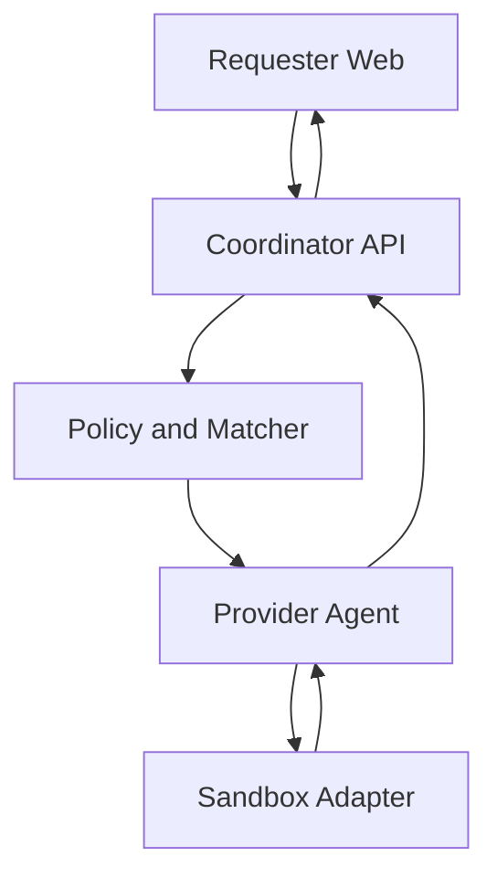

# Architecture

## Trust flow

The coordinator is a control plane, not a remote shell relay. The Agent establishes an outbound authenticated channel, advertises observed capabilities, receives signed short-lived offers, and owns the local kill path.

## Workspace boundaries

- `apps/web`: untrusted user interaction and sanitized result presentation
- `apps/api`: authorization, validation, policy, matching, leases, and events
- `apps/agent`: provider identity, capability probes, consent, local lifecycle, and cleanup
- `packages/contracts`: the only shared definition of states and request shapes

## Job lifecycle

`SUBMITTED → POLICY_CHECKED → OFFERED → APPROVED → CLAIMED → RUNNING → VALIDATING → SUCCEEDED`

Terminal failure states are `FAILED`, `CANCELLED`, and `EXPIRED`. Every transition must be validated server-side and written as an append-only event.

## Persistence boundary

PostgreSQL stores users, provider capabilities, workload definitions, jobs, assignments, and job
events. State changes lock the job row, validate the shared transition graph, update the current
state, and append an event in one transaction. A database trigger rejects updates or deletes on
`job_events`, so audit history cannot be silently rewritten by normal application queries.

## Cross-platform rule

Jobs target capabilities, not operating systems. A node may advertise container baseline, gVisor, or microVM isolation only after a runtime probe succeeds. Unsupported jobs are never offered to that node.
