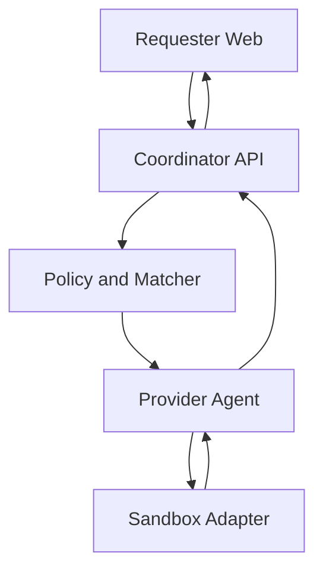

# Architecture

## Trust flow

The coordinator is a control plane, not a remote shell relay. The Agent establishes an outbound authenticated channel, advertises observed capabilities, receives signed short-lived offers, and owns the local kill path.

The coordinator owns the workload catalog. A requester selects a workload ID and validated
parameters; it cannot choose a container image, network mode, privilege, or resource envelope.
Matching uses fresh provider heartbeats and subtracts resources reserved by offered, approved,
claimed, running, or validating jobs before creating another offer. PostgreSQL serializes this check
with a provider-row lock so concurrent submissions cannot oversubscribe a node.

## Workspace boundaries

- `apps/web`: untrusted user interaction and sanitized result presentation
- `apps/api`: authorization, validation, policy, matching, leases, and events
- `apps/agent`: provider identity, capability probes, consent, local lifecycle, and cleanup
- `packages/contracts`: the only shared definition of states and request shapes

## Job lifecycle

`SUBMITTED → POLICY_CHECKED → QUEUED → OFFERED → APPROVED → CLAIMED → STAGING → RUNNING → VALIDATING → SUCCEEDED`

Terminal states are `REJECTED`, `DECLINED`, `EXPIRED`, `SUCCEEDED`, `FAILED`, `CANCELLED`, and
`TIMED_OUT`. A lease-expired idempotent job may move from `CLAIMED`, `STAGING`, or `RUNNING` back to
`QUEUED` only while another attempt remains. Every transition must be validated server-side and written as an
append-only event. `DRAFT` is client-only and is not a server job state.

## Persistence boundary

PostgreSQL stores users, provider capabilities, workload definitions, jobs, assignments, and job
events. State changes lock the job row, validate the shared transition graph, update the current
state, and append an event in one transaction. A database trigger rejects updates or deletes on
`job_events`, so audit history cannot be silently rewritten by normal application queries.

## Cross-platform rule

Jobs target capabilities, not operating systems. A node may advertise container baseline, gVisor, or microVM isolation only after a runtime probe succeeds. Unsupported jobs are never offered to that node.

## Offer trust boundary

The Agent opens the connection and polls; the coordinator never opens an inbound connection to a
provider machine. Every offer carries a canonical manifest signed with Ed25519, a pinned image
digest, a 256-bit nonce, and a short expiry. Provider approval and Agent claim are separate state
transitions. Claim atomically consumes the nonce and creates a bounded lease, so a captured request
cannot be replayed to start the job again.

## Execution result boundary

The image-transform workload writes one bounded image to stdout. The Agent checks the expected
format's magic bytes and size before marking the output validated, hashes stdout and stderr, and
sends only size/digest metadata to the coordinator. The current phase does not yet provide requester
artifact upload or downloadable output storage, so the demo image is embedded in the workload.
