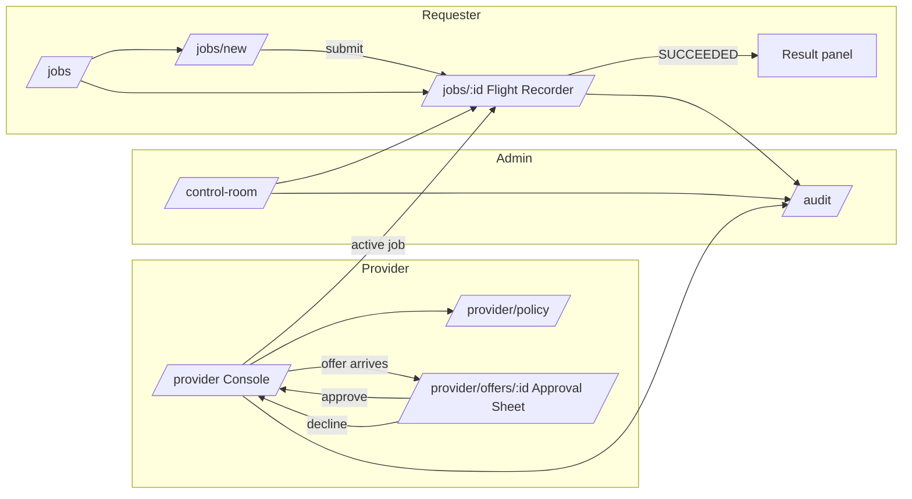

# G1 — Information Architecture & Route Map

Owner: Gargi · Reviewer: Kavya · Status: **draft v0 (2026-10-10)** · Master plan refs: §3, §6, §7, §8

**Done when** (master plan): all six surfaces have entry/exit paths and role access.

This document is also Gargi's **handoff to Kavya**: annotated flows plus the exact state and copy
requirements that the contracts (K2), risk-policy engine (K5) and SSE stream need to satisfy. Anything marked
**❓ Kavya** is a contract question that has to be settled in S1 (freeze v0 contracts).

---

## 1. Roles

| Role | Who | Home route | Can never see |
| --- | --- | --- | --- |
| `requester` | Person submitting a bounded job | `/jobs` | Provider address/IP, node owner identity, host paths, provider credentials |
| `provider` | Person sharing a capability from their node | `/provider` | Requester identity beyond community display name, requester inputs beyond what the Approval Sheet declares |
| `admin` | Community admin for a campus/lab pool | `/control-room` | Raw secrets, tokens, manifest signatures (shows "verified ✓" only) |

A single person may hold more than one role; the shell shows a role switcher only when they do (MVP: the
mock session lets you switch for demos — real auth is K4).

---

## 2. Route map

Next.js App Router, `apps/web/src/app`. Every route is server-guarded by role (K4) **and** hides nav entries
the user can't use (UI never relies on hiding alone).

| Route | Surface | requester | provider | admin | Notes |
| --- | --- | :-: | :-: | :-: | --- |
| `/` | — | → `/jobs` | → `/provider` | → `/control-room` | Redirect to role home |
| `/control-room` | **Control Room** (G9) | ◐ | ◐ | ● | ◐ = aggregate health only, no node list |
| `/jobs` | Job list (part of Flight Recorder) | ● own | — | ● all | Entry to Composer and Recorder |
| `/jobs/new` | **Requester Job Composer** (G4) | ● | — | — | |
| `/jobs/[jobId]` | **Job Flight Recorder** (G7) + **Result** (G8) | ● own | ◐ assigned | ● | Provider sees jobs on their node with sanitized params, no requester inputs preview |
| `/provider` | **Provider Console** (G5) | — | ● | — | Availability, capability, active job, kill switch |
| `/provider/policy` | Provider policy editor (part of G5) | — | ● | ◐ read | `GET/PUT /v1/nodes/:id/policy` |
| `/provider/offers/[offerId]` | **Approval Sheet** (G6) | — | ● | — | Rendered as a modal sheet over `/provider`; also deep-linkable |
| `/audit` | **Policy & Audit** (G10) | ● own jobs | ● own node | ● all | Role-scoped `GET /v1/audit` |

Legend: ● full · ◐ scoped/read-only · — no access (403 page with "You don't have access to this" + link home).

Deferred (not MVP surfaces): `/admin/nodes` (approve nodes), `/admin/workloads` (approve workloads). Admin
reviews these through Control Room + Audit in MVP.

---

## 3. Surfaces: entry and exit paths

### 3.1 Control Room — `/control-room`
- **Purpose:** network health and active work at a glance.
- **Entry:** admin home; nav item for all roles.
- **Exit:** click active job → `/jobs/[id]`; click incident → `/audit?event=…`; click node (admin) → filtered audit for that node.
- **Critical states:** `healthy` · `degraded` (coordinator reachable, some nodes stale) · `no providers` · `incident` (open incident banner).
- **Content hierarchy:** 1) health status line with reason in words · 2) capacity (nodes available / busy / offline) · 3) active jobs table · 4) node list (admin only) with *verified* isolation level only.

### 3.2 Requester Job Composer — `/jobs/new`
- **Purpose:** choose an approved capability, inputs, limits and network mode.
- **Entry:** "New job" button on `/jobs`, empty-state CTA on `/jobs`.
- **Exit:** submit → `/jobs/[id]` (state `SUBMITTED`, then `QUEUED` or `REJECTED`); cancel → `/jobs`.
- **Critical states:** `valid` · `invalid` (field-level errors) · `blocked with reason` (risk tier BLOCKED, submit disabled, reason shown) · `queued` (after submit).
- **Steps (single page, 4 sections):** Workload (signed catalog only) → Inputs (upload, type/size checked client-side as UX only) → Parameters & limits (fixed by workload schema) → Network & risk (OFFLINE default; risk tier + plain-language reasons live-updated) → Submit.

### 3.3 Provider Console — `/provider`
- **Purpose:** set availability / capability / policy and stay in control.
- **Entry:** provider home.
- **Exit:** pending offer → Approval Sheet; active job → `/jobs/[id]`; "Edit policy" → `/provider/policy`; audit link.
- **Critical states:** `offline` (Agent not connected) · `available` · `offer pending` · `running` (kill switch pinned) · `stopped` (just killed; shows what was stopped and when).
- **Must show separately:** **Agent status** (local, from heartbeat) vs **Coordinator status** (control plane reachability). Principle: an outage must be understandable.
- **Kill switch:** persistently visible while any job is RUNNING/STAGING/CLAIMED on this node. Works without coordinator (master plan §4 kill path) — UI copy must not imply the coordinator is needed.

### 3.4 Approval Sheet — `/provider/offers/[offerId]`
- **Purpose:** explain workload, data, limits, network and risk **before** consent.
- **Entry:** offer notification in Provider Console (live region announces it); direct link.
- **Exit:** Approve once → back to Console (job becomes CLAIMED); Decline → Console; Esc/close → Console with offer still pending; offer expires while open → sheet switches to "This request expired" with only a Close action.
- **Critical states:** `approve once` · `decline` · `policy auto-approve` (read-only record explaining which policy rule approved it) · `expired`.
- **Must display:** workload name + version + digest (short, copyable) + signature verified · input count, types, total size · CPU/RAM/disk/time limits · network mode · risk tier + every risk fact · offer expiry countdown.

### 3.5 Job Flight Recorder — `/jobs/[jobId]`
- **Purpose:** live state timeline, progress, logs, resource limits and result.
- **Entry:** after submit; job list; Control Room; Provider Console active job.
- **Exit:** back to `/jobs`; audit for this job → `/audit?jobId=…`; Cancel (requester, non-terminal states) → stays, shows CANCELLED.
- **Critical states:** `running` · `retrying` · `failed` · `cancelled` · `succeeded` — plus connection states `live` · `reconnecting` · `stale` (no event for > 2× heartbeat).
- **Rules:** timeline is append-only, de-duplicated by event id; resumes from `Last-Event-ID` on reconnect; never invents a state not received.

### 3.6 Result experience (inside Flight Recorder) — G8
- Only when job is `SUCCEEDED`. Shows artifact list: name, content type, size, SHA-256 digest, validation checks passed.
- **Preview only for allowlisted raster types** (`image/png`, `image/jpeg`, `image/webp`) rendered via `` from a scoped URL. **SVG/HTML never previewed** — download only. No `dangerouslySetInnerHTML` anywhere in the app.

### 3.7 Policy & Audit — `/audit`
- **Purpose:** show why jobs were allowed/blocked and what happened.
- **Entry:** nav; deep links from Recorder, Console, Control Room.
- **Exit:** event row → related job or node.
- **Critical states:** `filtered events` · `export` (CSV/JSON of what's on screen) · `empty` ("No events match these filters").
- **Columns:** time · actor (role + display name) · event · job/node · reason · correlation id (copyable).

---

## 4. Annotated flows

### 4.1 Requester — happy path (demo 1:30–2:20, 3:00–4:15, 5:00–5:45)
1. `/jobs` → **New job**.
2. Pick **Image transform v1** (only signed workloads are listed; each shows "Signed · digest sha256:ab12…").
3. Add images (PNG/JPEG/WebP, ≤ N files, ≤ M MB each — limits come from the workload `inputSchema`).
4. Choose output format / max width / quality (enum + bounded numbers only).
5. Network shows **OFFLINE (default)**; risk panel: **LOW** — "Signed workload · fixed input schema · no network".
6. **Submit** → `/jobs/[id]`. Timeline: Submitted → Queued → Offered → Claimed → Staging → Running → Validating → Succeeded.
7. Result panel: previews + digests + **Download**.

### 4.2 Requester — blocked
- At step 5, if a combination is BLOCKED, Submit is disabled and the panel lists the blocking facts in words.
  The server is still the authority: if `POST /v1/jobs` returns REJECTED, the Recorder shows the same reasons.

### 4.3 Provider — join and approve (demo 0:45–1:30, 2:20–3:00)
1. `/provider` shows **Agent: connected** / **Coordinator: reachable**, node capability card (OS, arch, runtime, *verified* isolation), availability toggle.
2. Offer arrives → polite live-region "New request: Image transform, LOW risk. Review it before it expires." and a
   lime "Needs your decision" card with a countdown. **Decision (Gargi, 2026-10-10):** the sheet does *not* auto-open —
   a modal that steals focus mid-task is an accessibility failure. One click on **Review request** opens it.
3. Approval Sheet opens focus-trapped with initial focus on **Decline** (the safe default), so Enter never approves by
   accident. **Approve once** → back to the Console, which now shows the pinned kill bar.

### 4.4 Provider — kill (demo 4:15–5:00)
1. While running, **Stop job** is pinned (keyboard: focusable, `Ctrl/⌘ + .` shortcut announced).
2. Confirm dialog: "Stop this job now? The sandbox is terminated and its network is revoked. This can't be undone." → **Stop now**.
3. UI shows "Stopping…" ≤ 5 s → "Stopped by you at 14:02:11". Audit records actor + reason.

### 4.5 Admin — trace
`/control-room` → incident or job → `/audit?jobId=…` → each transition with actor, reason, correlation id.

---

## 5. State → copy requirements (handoff to Kavya)

UI renders **only** these states (master plan §3). Labels are always text + icon + color (never color alone).

| State | Badge | Requester copy | Provider copy | Tone |
| --- | --- | --- | --- | --- |
| DRAFT | Draft | Not submitted yet. | — | neutral |
| SUBMITTED | Checking | Checking your job against policy… | — | info |
| REJECTED | Rejected | Rejected before scheduling. {reasons} | — | danger |
| QUEUED | Queued | Waiting for a compatible provider. | — | info |
| OFFERED | Offered | Offered to a provider — waiting for their approval. | New request awaiting your approval. | info |
| DECLINED | Declined | The provider declined this request. | You declined this request. | neutral |
| EXPIRED | Expired | No provider accepted in time. | This request expired. | neutral |
| CLAIMED | Claimed | A provider accepted. Preparing to run. | You accepted. Preparing the sandbox. | info |
| STAGING | Staging | Staging inputs read-only. | Staging inputs read-only. | info |
| RUNNING | Running | Running in an isolated sandbox · {networkMode}. | Running · stop any time. | active |
| VALIDATING | Validating | Checking output type, size and digest. | Validating output. | info |
| SUCCEEDED | Succeeded | Result validated and ready. | Completed. Workspace cleaned. | success |
| FAILED | Failed | Failed: {reason}. | Failed: {reason}. | danger |
| CANCELLED | Stopped | Stopped by {actorLabel}. {reason?} | Stopped by {actorLabel}. | warning |
| TIMED_OUT | Timed out | Stopped — exceeded the {limit} time limit. | Stopped — time limit reached. | warning |

Risk tier badges: **LOW** (ink on lime-tint) · **MEDIUM** (amber) · **HIGH** (orange, "Not run on personal devices") · **BLOCKED** (red, "Rejected before scheduling"). Each badge always comes with its reason list.

### Vocabulary (decision right: Gargi)
Use: *submit, approve, decline, run, stop, validate, return, share a capability*.
Never use: *connect to, access, remote, control their machine, rent, shell, terminal*.

---

## 6. Contract requests / ❓ Kavya

These must land in `packages/contracts` before Gargi wires real screens (dependency handshakes, §8).

1. **❓ Retry representation.** "Retrying" is a Flight Recorder critical state and K11 allows one requeue, but
   the canonical table has no `→ QUEUED` from CLAIMED/STAGING/RUNNING. Proposal: keep job state, add
   `attempt` number on events and a `LEASE_EXPIRED` event type followed by `QUEUED` with `attempt: 2`. Needs a
   state-table amendment (both owners must agree — it changes the job contract).
2. **❓ Is DECLINED/EXPIRED of an offer terminal for the job**, or does the matcher re-offer to another node? UX
   copy differs ("No provider accepted" vs "Trying another provider").
3. **❓ Risk explanation object.** Proposal:
   `{ tier: 'LOW'|'MEDIUM'|'HIGH'|'BLOCKED', facts: Array<{ code: string, label: string, effect: 'lowers'|'raises'|'blocks', detail?: string }>, decidedAt, policyVersion }`.
   UI renders `label` verbatim — so labels are user-facing copy, reviewed by Gargi.
4. **❓ Error envelope.** Proposal: `{ error: { code: 'VALIDATION_FAILED'|'RISK_BLOCKED'|'NOT_FOUND'|'FORBIDDEN'|'CONFLICT'|'OFFER_EXPIRED'|'RATE_LIMITED'|'INTERNAL', message, fields?: Record<string,string>, correlationId } }`.
5. **❓ SSE event shape** (`GET /v1/jobs/:id/events`). Proposal: SSE `id` = monotonic per-job sequence, `event` =
   `state` | `progress` | `log` | `heartbeat`, `data` = `{ seq, jobId, type, state?, progress?{done,total}, message?, actor, reason?, at, correlationId, attempt }`. Supports `Last-Event-ID` resume.
6. **❓ Node capability view** must separate *declared* vs *verified* isolation (K12) so the UI never overclaims gVisor.
7. **❓ Kill path event:** provider-initiated stop should emit `CANCELLED` with `actor: {role:'provider'}` and a
   `reason` code `PROVIDER_STOP`; requester cancel uses `REQUESTER_CANCEL`.
8. **❓ Approval Sheet data:** the offer needs workload name/version/digest/signatureVerified, input summary
   (count, types, total bytes — no filenames needed), limits, networkMode, risk object, `expiresAt`.

9. **❓ Where does the Provider Console talk to?** The kill switch must work *without* the coordinator (§4 kill
   path) and offer decisions are signed by the Agent identity. That implies the Console (or at least its kill
   button and offer decision) talks to a **local Agent endpoint** (e.g. `http://127.0.0.1:<port>`, loopback
   only, local token), with the coordinator as a mirror. Proposal: web app reads node/offer state from the
   coordinator, but `stop` and `decision` go to the local Agent first; UI shows "Agent unreachable" if the
   local endpoint is down. Needs an ADR.

10. **❓ Requester cancel while OFFERED.** The canonical table has no `OFFERED → CANCELLED`, so a requester can't
    cancel during the (≤ 60 s) approval window. The UI currently disables Cancel with an explanation. Add the
    transition, or confirm this is intended?
11. **❓ Read endpoints missing from API v0** that the screens need: `GET /v1/jobs` (list, role-scoped),
    `GET /v1/workloads` (catalogue), `GET /v1/nodes` (capability view), `GET /v1/network` (Control Room health),
    `GET /v1/offers/:id` (Approval Sheet deep link). The mock implements them at those paths.
12. **❓ Requester-facing actor labels.** Events and audit rows shown to requesters must not reveal the node label
    or provider identity. The mock projects actors to "Provider agent" / "Provider" for requesters — the real API
    should do the same server-side.

Until these land, the web app runs on **provisional fixtures** in `apps/web/src/contracts-draft/` that follow
these proposals; they're marked DRAFT and replaced by `@powermesh/contracts` in S1.
